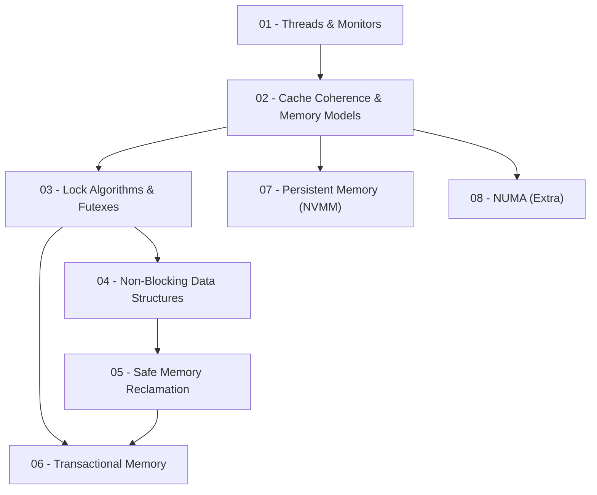

# CSC5101 — Advanced Programming of Multicore Architectures

> [!info] Course Overview
> **Program:** M1 Parallel & Distributed Systems (IP Paris) / CHPS (Université Paris-Saclay)  
> **Instructor:** Gaël Thomas  
> **Scope:** 30h of lectures and labs covering multicore systems programming in C: POSIX threads, cache coherence & memory models, lock algorithms & futexes, lock-free data structures, safe memory reclamation, transactional memory, persistent memory (NVMM), and NUMA (extra).

---

## Concept Notes (Core Curriculum)

1. [[01 - Processes, Threads and Monitors]] — `#csc5101/threads`
2. [[02 - Cache Coherence and Memory Models]] — `#csc5101/memory-model`
3. [[03 - Lock Algorithms and Futexes]] — `#csc5101/locks`
4. [[04 - Non-Blocking Data Structures]] — `#csc5101/non-blocking`
5. [[05 - Safe Memory Reclamation (ABA, Hazard Pointers, RCU)]] — `#csc5101/reclamation`
6. [[06 - Transactional Memory (STM, HTM, HyTM)]] — `#csc5101/tm`
7. [[07 - Persistent Memory (NVMM and Crash Consistency)]] — `#csc5101/nvmm`

### Extra / Optional Module
- [[08 - NUMA Architecture (Extra)]] — `#csc5101/numa` `#csc5101/extra` *(not required for the current exam; kept for vault completeness)*

---

## Lab Notes (TPs & Implementations)

- [[Lab 01 - Threads and Producer-Consumer]] → accompanies [[01 - Processes, Threads and Monitors]]
- [[Lab 02 - Lock Benchmarks and Futex Mutex]] → accompanies [[03 - Lock Algorithms and Futexes]]
- [[Lab 03 - Lock-Free Queue, Stack, Radix Tree, Linked List]] → accompanies [[04 - Non-Blocking Data Structures]] & [[05 - Safe Memory Reclamation (ABA, Hazard Pointers, RCU)]]
- [[Lab 04 - Global-Clock STM Runtime]] → accompanies [[06 - Transactional Memory (STM, HTM, HyTM)]]
- [[Lab 05 - NVMM Write-Ahead Cache (NVCache)]] → accompanies [[07 - Persistent Memory (NVMM and Crash Consistency)]]
- [[Lab 06 - NUMA Latency Measurement (Extra)]] → accompanies [[08 - NUMA Architecture (Extra)]]

---

## Exam Preparation & Past Papers

- [[Exam Patterns and C11 Atomics Reference]] — Quick-reference syntax, traps, and recurring theory questions
- [[Past Exam 2021-2022 - Radix Tree]] — NUMA, Memory Model, eADR, Lock-Free Radix Tree, TM
- [[Past Exam 2022-2023 - Barrier and Flat Combining]] — Barriers (POSIX/Atomic/Futex/TM), `sfence`, MCS Flat Combining
- [[Past Exam 2023-2024 - Lock-Free Memory Allocator]] — TSO vs General Memory Model, Lock-Based & Lock-Free Chunk Allocator
- [[Past Exam 2024-2025 - Userspace RCU]] — Userspace RCU, RCU Sorted Linked List, Redo/Undo Logs, Memory Ordering
- [[Past Exam 2025-2026 - Work-Stealing Scheduler]] — Lock-Free Task-Stealing Workers & Lock-Free Termination, HTM, Locks, NUMA

---

## Concept Dependency Map

## Tag Taxonomy

| Tag | Meaning |
|---|---|
| `#csc5101/moc` | Map of Content / Index |
| `#csc5101/threads` | Processes, POSIX threads, mutexes, condition variables |
| `#csc5101/memory-model` | Cache coherence, TSO, ARM, C11 atomics, fences |
| `#csc5101/locks` | Bakery, Spinlock, Ticket, MCS, Futex, Flat Combining |
| `#csc5101/non-blocking` | Amdahl's Law, Wait/Lock/Obstruction-free, Stack, Queue, Harris List |
| `#csc5101/reclamation` | ABA problem, Hazard Pointers, RCU |
| `#csc5101/tm` | STM, HTM, HyTM, `retry`/`orElse`, Zombie Transactions, Redo/Undo logs |
| `#csc5101/nvmm` | DAX, `pwb`/`pfence`/`psync`, eADR, NVCache, `ptail`/`vtail` |
| `#csc5101/numa` | First-touch, Interleaved, `hwloc` (`#csc5101/extra`) |
| `#csc5101/lab` | Lab assignment & implementation notes |
| `#csc5101/exam` | Past exam problems, solutions, and grading patterns |
